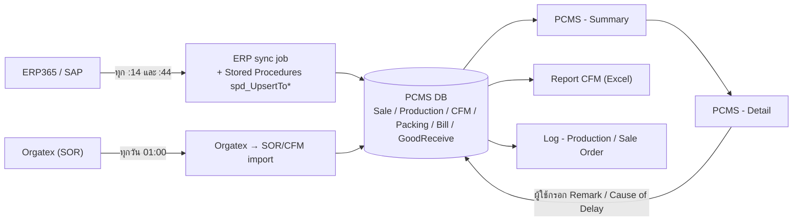
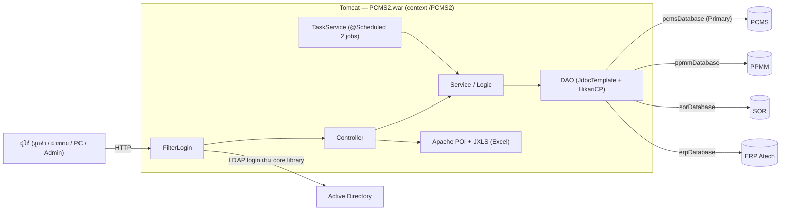

# PCMS2 — Production / Sale Order Monitoring

ระบบติดตาม Sale Order และ Production Order ของ Wacoal ที่ดึงข้อมูลจาก SAP (ERP365) และ SOR อัตโนมัติ
ให้ฝ่ายขาย/ลูกค้า/PC ดูสถานะงานเป็นรายใบ ดู CFM, packing, bill, good receive และบันทึกหมายเหตุ/สาเหตุล่าช้าได้
สร้างด้วย Spring MVC 5.2 + JSP + SQL Server (WAR บน Tomcat)

> **โครงสร้าง repo:** git root คือโฟลเดอร์นี้ · โค้ดที่ใช้งานอยู่ใน `PCMS2/` (Maven project) ·
> โฟลเดอร์ `PCMS/` ที่เห็นข้างๆ เป็นโค้ดชุดเก่า ยังไม่ถูก track ใน git และไม่เกี่ยวกับ build ของ PCMS2

## ความสามารถหลัก

- **PCMS - Summary** (`/Main`): ภาพรวม Sale Order พร้อมตัวกรองสถานะ (ค่าเริ่มต้น "In-Process" — SO ที่ปิดแล้วต้องเลือก "All")
- **PCMS - Detail** (`/Detail`): รายละเอียดราย SO/Line และ Production Order, แถว WaitLot (`รอจัด Lot`), Download Excel
- ผู้ใช้กรอกข้อมูลเพิ่มเองได้ที่หน้า Detail เช่น Replaced Remark, PC Remark, Delayed Dep, Cause of Delay, Stock Load
- **Report → CFM Detail**: รายงาน CFM ออกเป็น Excel (Apache POI + JXLS template)
- **Log**: ประวัติการเปลี่ยนแปลง Production Order / Sale Order (แยกฝั่ง ATT กับ ERP365)
- **Setting**: Job Management (ดู/รัน/เปิด-ปิดงานดึงข้อมูล), Permit Management (สิทธิ์ผู้ใช้)
- ดึงข้อมูล ERP/SOR เข้า PCMS DB อัตโนมัติด้วย `@Scheduled` 2 งาน

## Flow ข้อมูล

> สรุปจากโค้ดและ `PCMS2/docs/background-jobs.md` (เอกสาร business ของ repo นี้ยังเป็น template ว่าง — ดูหัวข้อ "สิ่งที่ยังขาด")



## สถาปัตยกรรมระบบ



| องค์ประกอบ | ข้อกำหนด |
|---|---|
| Java | JDK 1.8 (ต้อง set `JAVA_HOME` เสมอ) |
| Build | Maven 3.x → `PCMS2/target/PCMS2.war` |
| Framework | Spring MVC 5.2, JSP, Bootstrap 4, Gson (ห้ามใช้ Jackson), JasperReports 6.16, POI 5.2.5, JXLS 2.13 |
| Server | Tomcat 8.5 / 9 · production `http://10.11.44.100:8080/PCMS2` |
| DB | 4 datasource: `pcmsDatabase` (@Primary), `ppmmDatabase`, `sorDatabase`, `erpDatabase` |
| Auth | `FilterLogin` (ไม่ใช้ Spring Security) + LDAP ผ่านไลบรารี `core` |
| DB access | HikariCP + `JdbcTemplate` + mssql-jdbc 9.4.1 |

## โครงสร้าง repo

| โฟลเดอร์ | หน้าที่ |
|---|---|
| `PCMS2/src/main/java/th/co/wacoal/atech/pcms2/` | `config/` (4 DB, scheduler), `controller/`, `service/`, `logic/`, `dao/implement/`, `entities/`, `filter/`, `utilities/` |
| `PCMS2/src/main/webapp/WEB-INF/pages/` | JSP แยกตามหน้า (`PCMSMain/ PCMSDetail/ Report/ LogInformation/ Setting/`) |
| `PCMS2/src/main/webapp/resources/` | JS / CSS / static |
| `PCMS2/sql/` | SQL patch เรียงตามวันที่ — **รันมือใน SSMS** (ไม่มี migration framework) |
| `PCMS2/docs/` | architecture, database, deployment, background jobs, ขั้นตอนทดสอบ PERF_SEARCH |
| `PCMS2/tools/` | `dev-web-local/` (รันแอปชี้ DEV), `run-harness-ab.ps1` + `harness-ab-diff.py` (เทียบผลค้นหาเก่า/ใหม่) |
| `PCMS2/NEXT_SESSION.md` | งานค้างและสถานะล่าสุด — **อ่านก่อนเริ่มทำงาน** |
| `PCMS2/CLAUDE.md` | กฎ/รูปแบบโค้ดของโปรเจกต์ |

## เริ่มต้นใช้งาน (นักพัฒนา)

```powershell
$env:JAVA_HOME = "C:\Program Files\Java\jdk-1.8"
cd PCMS2
mvn clean compile                # ตรวจ compile
mvn clean package -DskipTests    # → target/PCMS2.war
mvn test                         # JUnit 4
```

1. ตั้งค่า `src/main/resources/database.properties` (credentials 4 DB) — ไฟล์นี้ขึ้นได้เฉพาะ remote ของบริษัท (`gitlab_master`) **ห้าม push ขึ้น `origin` (GitHub ส่วนตัว)**
2. รัน SQL ใน `PCMS2/sql/` ที่ยังไม่เคยรัน ตามลำดับวันที่
3. Deploy: Eclipse → Run on Server (Tomcat) context path `/PCMS2` · production: คัดลอก `PCMS2.war` ไป `[TOMCAT_HOME]/webapps/`
4. ทดสอบหน้าเว็บบนเครื่องชี้ DEV: [`PCMS2/tools/dev-web-local/README.md`](PCMS2/tools/dev-web-local/README.md) (พอร์ต 8082 · ล็อกอิน `ZZTEST` สิทธิ์ `VIEWONLY` · ปิด scheduled jobs)

รายละเอียด deploy: [`PCMS2/docs/deployment.md`](PCMS2/docs/deployment.md)

## Background jobs

ทั้งหมดอยู่ใน `service/TaskService.java` เปิด/ปิดและรันมือ (ช่วงวันที่ ≤ 7 วัน) ได้ที่ Setting → Job Management

| งาน | รอบ | ทำอะไร |
|---|---|---|
| `bgJobHandlerDataFromOrgatex` | ทุกวัน 01:00 | นำเข้า Orgatex → SOR/CFM (upsert `FromSORCFM`) |
| `sortBackGroundAfterGetERPDataProcedure` | ทุกชั่วโมงที่ :14 และ :44 | sync ERP เต็มรูปแบบ: Customer Confirm, Customer, Sale Order, Production Order (7 stored procedures), สรุป Bill/Good Receive |

รายละเอียดเต็ม: [`PCMS2/docs/background-jobs.md`](PCMS2/docs/background-jobs.md)
**ข้อควรระวัง:** อย่าสตาร์ตแอปบนเครื่อง DEV ใกล้เวลา cron — filter ปิด job ได้หลัง context พร้อมเท่านั้น

## สิทธิ์ผู้ใช้

สิทธิ์เก็บในตาราง Permits และจัดที่ Setting → Permit Management · role ที่พบในระบบ/สคริปต์ SQL: `ADMIN`, `ITSUPP`, `CUST01`, `CUST02`, `VIEWONLY`
(DEV มีเฉพาะ `CUST01` / `CUST02` / `VIEWONLY`)

## ข้อควรระวัง (อ่านก่อนแก้โค้ด)

- เลือก `@Qualifier` ให้ถูกทุก DAO — ผิด qualifier = ผิด DB
- **#temp table:** query ฝั่งอ่านใช้ `SqlStatementHandler.queryList(jdbc, PCMSSqlService.dropAllTemp, sql)` และเพิ่มชื่อ temp ใหม่ใน `dropAllTemp` · **ห้าม**เพิ่ม `#tempLotNoList / #tempUserStatusList / #tempCustomerList / #tempCustomerShortList` (ของ PCMSSearch) ใน `dropAllTemp`
- งานเขียน (FromSap* DAO) ใช้ pattern B: DROP temp ใน `finally` ก่อน `setAutoCommit(true)`
- ห้ามกดอะไรบน DEV ที่ยิงไป ERP/SOR จริง — ตรวจ config ก่อน (สคริปต์ dev-web-local จะหยุดเองถ้าไม่ใช่ DEV ครบทั้ง 4 ตัว)
- ก่อนบอกว่าเสร็จ ต้องทดสอบจริงบนหน้าเว็บ ไม่ใช่แค่ผ่าน test
- push ต้องทำ 2 remote: `origin` (GitHub ส่วนตัว) และ `gitlab_master` (GitLab บริษัท)

## สถานะงานปัจจุบัน

- branch `PERF_SEARCH` (MR !4 → `main`) ปรับความเร็วหน้าค้นหา · ขั้นตอนทดสอบบน PRD: [`PCMS2/docs/prd-verification-perf-search.md`](PCMS2/docs/prd-verification-perf-search.md)
- งานล่าสุดและงานค้าง: [`PCMS2/NEXT_SESSION.md`](PCMS2/NEXT_SESSION.md)
- `main` ยังไม่มีโฟลเดอร์ `docs/` และ `tools/` — เอกสารทั้งหมดในหัวข้อนี้อยู่บน `PERF_SEARCH`

## สิ่งที่ยังขาด

- `PCMS2/docs/business/*.md` (roles / workflow / rules) ยังเป็น **template ว่าง** — ยังไม่มีเอกสาร status machine และ business rule ของ PCMS2
- `PCMS2/docs/pcms2.md` (SAP integration quirks, PCMSSearch lifecycle) ยังเป็น TODO
- ยังไม่มีคู่มือผู้ใช้ (ระบบพี่น้อง LBMS / PPMM2 มี)

## เอกสารเพิ่มเติม

| หัวข้อ | ไฟล์ |
|---|---|
| สถาปัตยกรรม / package | `PCMS2/docs/architecture.md` |
| ฐานข้อมูล / กฎ SQL patch | `PCMS2/docs/database.md` |
| API convention | `PCMS2/docs/api.md` |
| Coding standards | `PCMS2/docs/coding-standards.md` |
| Web API integration | `PCMS2/docs/webapi-integration.md` |
| ADR (การตัดสินใจเชิงออกแบบ) | `PCMS2/docs/decision-records/` |

## ระบบที่เกี่ยวข้อง

ใช้ไลบรารี `core` (LDAP) ร่วมกับ LBMS, PPMM2, SFC · อ่านข้อมูล PPMM (แผนผลิต), SOR และ ERP Atech
